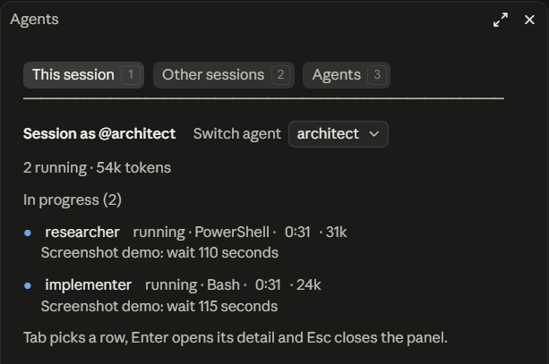
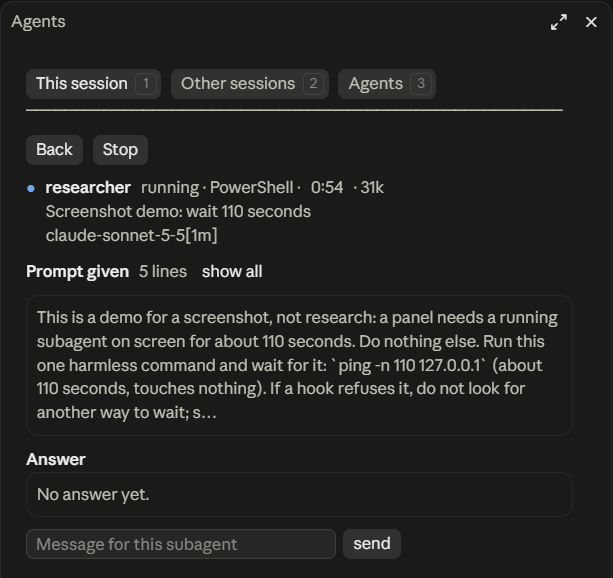
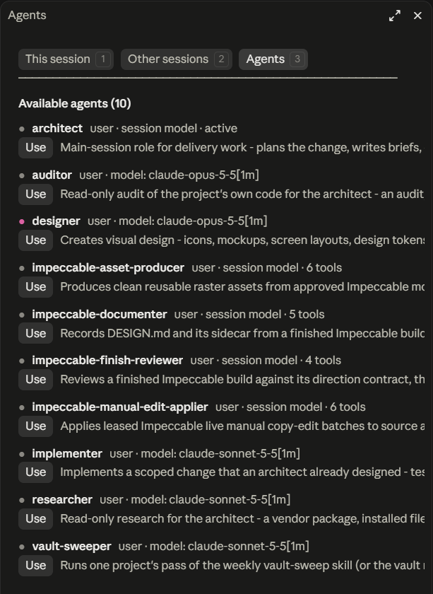
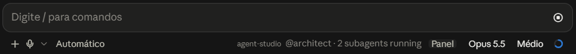

# agent-studio

[English](README.md) | Português

Um plugin do Claude Code para o Code tab do app Claude no desktop. Ele faz uma sessão atuar como um dos seus agentes de `.claude/agents`, e mostra num painel os subagentes da sessão e as suas outras sessões abertas.



As imagens mostram o plugin em inglês, que é o padrão. Com a opção `language` em `pt-BR`, os textos aparecem em português, com os nomes usados neste arquivo.

## O que ele faz

O plugin tem duas partes, e cada uma pode ser desligada sozinha.

O Launcher acrescenta o `/as`. Digitar `/as architect` faz a sessão atuar como o agente `architect`: o corpo do arquivo vira o system prompt, e o modelo, o effort e as restrições de ferramenta dele passam a valer no loop principal. Num terminal você conseguiria o mesmo com `claude --agent architect`. O app do desktop não tem essa opção, e o plugin a fornece.

O Monitor acrescenta o `/agent-panel` e um botão Painel embaixo do prompt. O painel lista os subagentes da sessão, com status, tempo e tokens. Lista também as outras sessões do Claude Code abertas na máquina e os agentes para os quais você pode trocar.

## Para que serve

No app do desktop os subagentes rodam fora da vista. Você vê que um começou e vê o relatório quando ele termina. O painel mostra quais ainda estão rodando, o que foi pedido a cada um e o que cada um respondeu, e deixa você parar um deles ou mandar uma mensagem.

Os agentes são a outra metade. Se você guarda papéis em `.claude/agents` e os usa no terminal com `--agent`, o Launcher os leva para o Code tab, onde uma sessão troca de papel sem ser reiniciada.

## O painel

O `/agent-panel` abre o painel, e o botão Painel também. Ele tem três abas, que trocam com `1`, `2` e `3`.

### Esta sessão

A primeira imagem mostra esta aba. Cada subagente ocupa duas linhas. A primeira traz uma marca de status, o tipo do subagente, a ferramenta em uso, o tempo e os tokens. A segunda traz a tarefa que ele recebeu. A marca é azul enquanto o subagente roda, verde quando ele conclui, vermelha quando falha e cinza quando é parado.

Um resumo no topo conta os subagentes por status e soma os tokens. Os que estão rodando vêm primeiro, em Em andamento, e os outros ficam em Terminados.

A contagem de tokens deixa as leituras de cache de fora. A cada passo um subagente relê do cache a conversa inteira dele, e somar essas leituras faria um trabalho curto parecer milhões de tokens. O detalhe mostra o total com elas.

Acionar uma linha abre o subagente.



Voltar e Parar ficam no topo. Abaixo vêm o modelo, o prompt que o subagente recebeu (recolhido até você acionar `mostrar tudo`), a última resposta e um campo para mandar uma mensagem a ele. As respostas anteriores e as mensagens que você mandou ficam atrás do botão `Respostas anteriores`. O painel guarda as últimas 20 trocas de cada subagente, até a sessão fechar.

### Outras sessões

Esta aba lista as outras sessões locais que carregam o plugin, separadas em Abertas e Encerradas. Cada linha traz o título da sessão (ou o nome da pasta, quando ela não tem título), o agente, o estado e um tempo. Numa sessão no meio de um turno, o tempo é quanto o turno já durou. Numa sessão ociosa, é há quanto tempo ela parou.

Abrir uma sessão mostra a última resposta e os subagentes dela. Dali você manda uma mensagem, ou aciona Status para pedir uma linha sobre o que ela está fazendo.

### Agentes



A terceira aba lista os agentes que o plugin encontrou. Usar faz o que `/as nome` faz. Um agente que declara `color` no arquivo ganha uma bolinha dessa cor.

Quando a conversa já começou e o agente escolhido roda em outro modelo, o primeiro clique só mostra um aviso e troca o botão por Confirmar. O cache de prompt é guardado por modelo, e o turno seguinte leria a conversa inteira sem ele.

## Embaixo do prompt



A linha de status mostra o agente ativo, depois quantos subagentes estão rodando e quantas outras sessões estão no meio de um turno. Sessões ociosas não entram na conta. O botão Painel, ao lado, abre o painel.

## O comando `/as`

| Comando | O que faz |
| --- | --- |
| `/as architect` | Ativa o agente `architect` na sessão |
| `/as` | Abre o painel na aba Agentes |
| `/as ?` | Mostra o agente ativo, com modelo, effort e ferramentas |
| `/as off` | Volta ao comportamento padrão |
| `/as --reload` | Lê de novo as pastas de agentes |

Os agentes vêm de `.claude/agents` do projeto, da pasta de trabalho até a raiz do repositório, e de `~/.claude/agents`. Com dois agentes de mesmo `name`, vale o do projeto.

Do arquivo do agente o plugin aplica o corpo, `model`, `effort`, `tools`, `disallowedTools` e `initialPrompt`. As restrições valem só no loop principal, e os subagentes seguem as regras deles. Uma entrada `Agent(researcher, implementer)` em `tools` limita os tipos de subagente que a sessão dispara.

Os campos `mcpServers`, `hooks`, `permissionMode`, `memory`, `skills` e `maxTurns` são lidos e não aplicados. O `/as` avisa quando o agente tem algum deles.

O agente escolhido fica guardado por sessão. Ele volta depois de reabrir o app, de um `/clear` e de uma retomada.

### Quando a troca passa a valer

O Claude Code monta o system prompt no primeiro turno de uma conversa e só o refaz depois de um `/clear` ou de uma compactação. Por isso o `/as` vale por inteiro quando é a primeira coisa que você digita na sessão.

Com a conversa em curso, o modelo, o effort e as ferramentas trocam na hora, e as instruções do agente entram como uma mensagem oculta. O system prompt em si troca no próximo `/clear` ou na próxima compactação. A resposta do `/as` diz qual dos dois casos aconteceu, e avisa quando a troca muda o modelo.

### Agente padrão de um projeto

Com `{ "agent": "architect" }` no settings do projeto, uma sessão nova começa como esse agente. Um `/as off` vale mais que o padrão e continua valendo depois de reabrir o app.

Uma sessão que nasceu como agente nativo, com `claude --agent` ou com essa chave aplicada pelo próprio Claude Code num terminal, fica fora do Launcher. Nela o `/as` responde que a sessão já é aquele agente.

## Instalação

Rode num shell. O painel Terminal do app serve:

```sh
claude plugin install agent-studio --marketplace brunofgmag/agent-studio
```

A instalação vale para o seu usuário. Sessões abertas antes dela carregam o plugin depois que você reinicia o app.

De dentro de uma sessão `claude` no terminal, dá para digitar o comando de barra:

```
/plugin install agent-studio --marketplace brunofgmag/agent-studio
```

Digitar esse comando no prompt do app do desktop não instala nada. O app abre o catálogo de plugins dele, que não lista este repositório.

O plugin foi escrito e testado no Claude Code 2.1.296, no Windows. Ele precisa de uma versão que carregue módulos de hooks de plugin.

## Opções

| Opção | Padrão | Efeito |
| --- | --- | --- |
| Launcher (`enableLauncher`) | ligado | Registra o `/as` |
| Monitor (`enableMonitor`) | ligado | Registra o `/agent-panel`, o painel e o botão Painel |
| Share answers (`shareAnswers`) | ligado | Publica um trecho da última resposta da sessão para as outras sessões |
| Model aliases (`modelAliases`) | `opus=claude-opus-5-5,sonnet=claude-sonnet-5-5,haiku=claude-haiku-5-5` | Traduz um apelido como `model: opus` em id de modelo |
| Language (`language`) | `en` | Idioma dos textos: `en` ou `pt-BR` |

O Claude Code guarda as opções de plugin em `~/.claude/settings.json`, na chave `pluginConfigs`:

```json
{
  "pluginConfigs": {
    "agent-studio@agent-studio": { "options": { "language": "pt-BR" } }
  }
}
```

Numa sessão de terminal, o `/plugin` tem uma entrada Configure options para os mesmos valores. Também dá para definir uma opção na instalação, com `--config language=pt-BR`.

Com o Launcher e o Monitor desligados, o plugin não registra nenhum hook nem comando.

## Idioma

Os textos vêm em inglês por padrão, e em português do Brasil com `language` em `pt-BR`. Os nomes dos comandos são os mesmos nos dois idiomas. Os títulos das opções ficam em inglês, porque o manifesto do plugin não acompanha a opção.

## Limites

Em modo de permissão `auto`, o Claude Code recusa a mensagem que um plugin manda direto a um subagente ou a outra sessão. O painel então submete um pedido na conversa para o modelo mandar a mensagem, com o seu texto sem alteração. Nos modos `default` e `acceptEdits` a mensagem vai direto.

Na aba Outras sessões só aparecem sessões locais que carregam o plugin. Sessões na nuvem, no WSL e no VS Code não aparecem.

O app do desktop refaz o que um plugin desenhou toda vez que esse plugin, ou qualquer outro, pede um redesenho, e o botão sob o ponteiro perde o realce por um instante quando isso acontece. O painel só pede redesenho quando algo que ele mostra mudou, e os relógios dele andam num módulo próprio, que não precisa de redesenho.

Depois de reabrir o app, a linha de status volta a mostrar o agente no seu primeiro prompt, não antes.

## Rodando do código

```sh
git clone https://github.com/brunofgmag/agent-studio.git
claude --plugin-dir ./agent-studio
```

Para carregar o plugin em toda sessão, as do app do desktop inclusive, ponha o caminho da pasta na variável de ambiente `CLAUDE_CODE_PLUGIN_DIRS`. Um plugin carregado assim se chama `agent-studio@inline` em `pluginConfigs`.

```sh
claude plugin validate --strict .
claude plugin test .
```

O primeiro comando confere o manifesto e lista o que o módulo engancha e chama. O segundo roda os testes de `tests/`, que usam o kit de teste do Claude Code e não precisam de modelo nem de tela.

Para a checagem de tipos, instale a única dependência de desenvolvimento e rode o TypeScript:

```sh
npm install --prefix dev
npx --prefix dev --no-install tsc -p .
```

Os tipos vêm de `.claude-plugin/types/`, que o Claude Code grava quando uma sessão interativa carrega o plugin.

## Privacidade

O plugin não faz nenhuma requisição de rede. Ele lê os seus arquivos de agente, o settings do projeto e os eventos da sessão em que roda.

Cada sessão grava um resumo curto no armazenamento do plugin, em `~/.claude/plugins/store/`, para as suas outras sessões poderem listá-la: a pasta, o agente, o estado, os subagentes e, com Share answers ligado, até 300 caracteres da última resposta. Qualquer sessão da máquina que carregue o plugin consegue ler. Uma entrada é apagada 24 horas depois da última gravação da sessão dela.

`claude plugin validate --strict .` imprime a lista completa das chamadas que o plugin faz.

## Licença

MIT. Veja [LICENSE](LICENSE).
